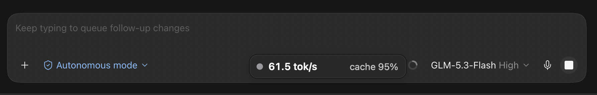

# TokenMeter for ZCode (macOS)

[中文文档](./README_CN.md)

A floating, always-on-top macOS widget for [ZCode](https://zcode.z.ai) that shows live token-generation speed and prompt-cache hit rate while the agent works.

```
● 62.2 tok/s    cache 87%
```



Inspired by [alixntuyt-eng/zcode-token-meter](https://github.com/alixntuyt-eng/zcode-token-meter) (Windows/WPF) — this is a native Swift/AppKit implementation for macOS.

## Features

- **tok/s** — live generation speed while a turn is running, last request's speed when idle (right-click → toggle tok/min)
- **cache hit %** — session-wide `cache_read / input_tokens`, matching ZCode's Developer tools → Token debug "Average hit"
- **LIVE/IDLE dot** — green while the model is generating, gray when idle
- **ZCode-only visibility** — shows only while ZCode is the frontmost app, hides everywhere else
- **Session picker** — right-click → pick any of your recent 10 chats to pin its stats, or "Auto"
- **Auto chat tracking** — follows the chat you last sent a message in
- **Drag to position** — position is remembered; unit preference and pinned session too
- **Private by design** — reads ZCode's local SQLite DB (`~/.zcode/cli/db/db.sqlite`) read-only. No network, no telemetry, no code execution.

## Requirements

- macOS 13+ (Apple Silicon or Intel)
- ZCode desktop app
- Xcode Command Line Tools (`xcode-select --install`) — only needed for building

## Install

### Option A — build & run manually

```bash
git clone https://github.com/Hasan5858/zcode-token-meter-mac.git
cd zcode-token-meter-mac/scripts
bash launch.sh
```

The first launch compiles the widget with `swiftc` and starts it. Stop it any time with:

```bash
bash stop.sh
```

### Option B — as a ZCode plugin (auto-start with every ZCode session)

1. Open ZCode → **Settings → Plugins → Create → Add marketplace**
2. Point it at this repository (or a local clone of this folder — it is a marketplace root containing `marketplace.json`)
3. Install **TokenMeter (macOS)** from the marketplace
4. Restart ZCode — the bundled `SessionStart` hook launches the widget in the background on every session

### Auto-start on ZCode launch (without installing the plugin)

Add this to `~/.zcode/cli/config.json` (create the file if it doesn't exist):

```json
{
  "hooks": {
    "enabled": true,
    "events": {
      "SessionStart": [
        {
          "hooks": [
            {
              "type": "process",
              "command": "/bin/bash",
              "args": ["/absolute/path/to/zcode-token-meter-mac/scripts/launch.sh"],
              "enabled": true,
              "timeoutMs": 15000
            }
          ]
        }
      ]
    }
  }
}
```

> The launch script spawns the widget with `start_new_session` (detached). If you replace it with a plain `nohup ... &`, a widget launched from a hook dies ~1 second later — ZCode kills the hook's process group when the hook finishes.

## How it reads your data

The widget opens `~/.zcode/cli/db/db.sqlite` (read-write flags required for fresh WAL snapshots — a read-only connection serves stale data) and queries the `model_usage` table:

- speed = `output_tokens / (completed_at − first_token_at)` — per model request, excluding tool-call wait time, so it matches the provider-reported tok/s
- cache % = `Σ cache_read_input_tokens / Σ input_tokens` — note ZCode's `input_tokens` already *includes* cached tokens; averaging per-request values double-counts and skews low

## Optional: per-chat auto tracking

ZCode gives no signal when you switch chats, so the widget cannot know which chat you are looking at. Two practical workarounds:

1. **Session picker** (built in) — right-click the widget and pin any recent chat
2. **Prompt-submit hook** — add a `UserPromptSubmit` hook that writes the current `session_id` to `~/.zcode/token-meter/current-session`; Auto mode reads it first. See the hook above for the exact format (event: `UserPromptSubmit`, a short `python3 -c` script parsing stdin JSON).

## Troubleshooting

**The widget never appears after install**

1. A first-launch build takes 30–60s — wait a minute after restarting ZCode.
2. If a build fails you get a **macOS notification** and a log is written to `~/.zcode/token-meter/build-error.log`. The most common cause is missing Xcode Command Line Tools — open Terminal and run:

   ```bash
   xcode-select --install
   ```

   click **Install**, wait for it to finish, then restart ZCode. The next session retries the build automatically.
3. Still nothing? Check the log (`cat ~/.zcode/token-meter/build-error.log`) and [open an issue](https://github.com/Hasan5858/zcode-token-meter-mac/issues) with its contents.

**An update doesn't show up in "Check for updates"**

The check runs against the locally cached marketplace manifest. Open **gear icon → Marketplace sources → this marketplace → Refresh**, then check again.

## What the plugin provides

| Component | Name | Purpose |
| --- | --- | --- |
| Hook | `SessionStart` | Auto-launches the widget in the background (detached, idempotent) and records the active session id |
| Hook | `UserPromptSubmit` | Records the session the user just messaged in, so the widget follows the right chat |
| Command | `/tokenmeter` | Start / stop / status of the widget from the composer |

The widget itself is a small native macOS app (Swift/AppKit) compiled on the user's machine at first launch by `scripts/build.sh` (via `swiftc`, so it builds natively for Apple Silicon and Intel).

## Security & side effects

- **Network access: none.** No telemetry, no analytics, no outbound requests of any kind.
- **Reads** `~/.zcode/cli/db/db.sqlite` (ZCode's local database, `model_usage` table) once per second to compute speed and cache-hit rate.
- **Hooks execute** two short `python3 -c` one-liners (write a session id to `~/.zcode/token-meter/current-session`) and one `/bin/bash` call to `scripts/launch.sh`.
- **`scripts/launch.sh`** runs `bash scripts/build.sh` (invokes `swiftc`) on first launch only, then spawns the compiled `token-meter` binary in a detached session. On build failure it writes `~/.zcode/token-meter/build-error.log` and posts a local macOS notification (`osascript display notification`).
- **Writes** only inside `~/.zcode/token-meter/` (session id file, build-error log) and the compiled binary next to its source.
- **No credentials, no customer data, no machine-specific paths, no prebuilt binaries** are committed; the binary is built locally and git-ignored.

## Known limitations

- Focused-tab detection is not possible: ZCode's Electron accessibility tree is disabled, and the DB never records which chat is open
- Brand-new chats show `no data yet` until their first turn completes
- The widget is a floating NSPanel — it cannot inject stats into ZCode's own toolbar (plugins cannot extend native app UI)

## License

MIT — see [LICENSE](LICENSE).
