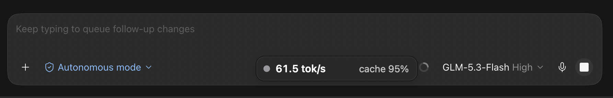

# ZCode TokenMeter（macOS）

[English](./README.md)

一个悬浮于屏幕之上、始终置顶的 macOS 小组件，在 ZCode 代理工作时实时显示 Token 生成速度与提示词缓存命中率。

```
● 62.2 tok/s    cache 87%
```



灵感来自 [alixntuyt-eng/zcode-token-meter](https://github.com/alixntuyt-eng/zcode-token-meter)（Windows/WPF 版）——本插件是面向 macOS 的原生 Swift/AppKit 实现。

## 功能特性

- **tok/s** —— 模型生成时实时显示速度；空闲时显示最近一次请求的速度（右键可切换 tok/min）
- **缓存命中率** —— 会话级 `cache_read / input_tokens`，与 ZCode 开发者工具 → Token debug 面板中的 "Average hit" 一致
- **LIVE/IDLE 指示点** —— 模型生成中显示绿色，空闲时显示灰色
- **仅在 ZCode 中显示** —— 只有 ZCode 位于前台时可见，切到其他应用自动隐藏
- **会话选择器** —— 右键小组件即可固定最近 10 个聊天中任意一个的统计数据，或选择 "Auto"
- **自动跟随聊天** —— 自动跟随你最近发送消息的聊天
- **拖拽定位** —— 位置会被记住；单位偏好与固定的会话同样会保存
- **隐私优先** —— 只读取 ZCode 本地 SQLite 数据库（`~/.zcode/cli/db/db.sqlite`）。无网络请求、无遥测。

## 环境要求

- macOS 13+（Apple Silicon 或 Intel 均可）
- ZCode 桌面版
- Xcode Command Line Tools（`xcode-select --install`）—— 仅编译时需要

## 安装

### 方式一 —— 手动编译运行

```bash
git clone https://github.com/Hasan5858/zcode-token-meter-mac.git
cd zcode-token-meter-mac/scripts
bash launch.sh
```

首次启动会用 `swiftc` 编译小组件并启动它。随时可以停止：

```bash
bash stop.sh
```

### 方式二 —— 作为 ZCode 插件（每次会话自动启动）

1. 打开 ZCode → **Settings → Plugins → Create → Add marketplace**
2. 填入本仓库：`Hasan5858/zcode-token-meter-mac`
3. 在 **Personal → zcode-token-meter-mac** 下点击 **TokenMeter (macOS)** 的 **Install**
4. 重启 ZCode —— 插件自带的 `SessionStart` 钩子会在每个会话后台自动启动小组件

### 不安装插件、随 ZCode 启动自动运行

在 `~/.zcode/cli/config.json` 中加入（文件不存在则新建）：

```json
{
  "hooks": {
    "enabled": true,
    "events": {
      "SessionStart": [
        {
          "hooks": [
            {
              "type": "process",
              "command": "/bin/bash",
              "args": ["/absolute/path/to/zcode-token-meter-mac/scripts/launch.sh"],
              "enabled": true,
              "timeoutMs": 15000
            }
          ]
        }
      ]
    }
  }
}
```

> 启动脚本以 `start_new_session` 方式（脱离会话组）拉起小组件。如果你换成普通的 `nohup ... &`，由钩子启动的进程会在钩子结束约一秒后被 ZCode 的进程组清理杀掉。

## 插件提供的内容

| 组件 | 名称 | 用途 |
| --- | --- | --- |
| 钩子 | `SessionStart` | 后台自动启动小组件（脱离会话组、幂等），并记录当前会话 id |
| 钩子 | `UserPromptSubmit` | 记录用户刚刚发消息的会话，让小组件跟随正确的聊天 |
| 命令 | `/tokenmeter` | 在输入框中启动 / 停止 / 查看小组件状态 |

小组件本体是一个原生 macOS 应用（Swift/AppKit），首次启动时由 `scripts/build.sh` 在用户机器上编译（调用 `swiftc`，因此 Apple Silicon 与 Intel 均编译为本机架构）。

## 安全性与副作用

- **无网络访问。** 无遥测、无统计、无任何对外请求。
- **读取** `~/.zcode/cli/db/db.sqlite`（ZCode 本地数据库的 `model_usage` 表），每秒一次，用于计算速度与缓存命中率。
- **钩子执行** 两段简短的 `python3 -c` 单行脚本（把会话 id 写入 `~/.zcode/token-meter/current-session`），以及一次对 `scripts/launch.sh` 的 `/bin/bash` 调用。
- **`scripts/launch.sh`** 仅在首次启动时运行 `bash scripts/build.sh`（调用 `swiftc`），随后以脱离会话的方式启动编译出的 `token-meter` 二进制。编译失败时会写入 `~/.zcode/token-meter/build-error.log`，并通过本地 macOS 通知（`osascript display notification`）提示。
- **写入** 仅发生在 `~/.zcode/token-meter/` 目录内（会话 id 文件、编译错误日志）以及源码旁边的编译产物。
- **不提交任何凭据、客户数据、机器特定路径或预编译二进制**；二进制在本地编译并被 git 忽略。

## 数据读取方式

小组件打开 `~/.zcode/cli/db/db.sqlite`（需要读写标志：只读连接在 WAL 模式下会读到过期快照），查询 `model_usage` 表：

- 速度 = `output_tokens / (completed_at − first_token_at)` —— 按单次模型请求计算，不含工具调用等待时间，因此与提供方报告的 tok/s 一致
- 缓存命中率 = `Σ cache_read_input_tokens / Σ input_tokens` —— 注意 ZCode 的 `input_tokens` 已经**包含**缓存命中的 token；若按单次请求值先平均再计算会重复计数、结果偏低

## 可选：按聊天自动跟踪

ZCode 在你切换聊天时不会发出任何信号，因此小组件无法知道你正在看哪个聊天。两个实用的解决办法：

1. **会话选择器**（内置）—— 右键小组件，固定任意最近的聊天
2. **消息提交钩子** —— 添加一个 `UserPromptSubmit` 钩子，把当前 `session_id` 写入 `~/.zcode/token-meter/current-session`；Auto 模式会优先读取该文件。格式参见上文的钩子示例（事件：`UserPromptSubmit`，一段解析 stdin JSON 的 `python3 -c` 短脚本）。

## 故障排查

**安装后小组件一直不出现**

1. 首次编译需要 30–60 秒 —— 重启 ZCode 后稍等一分钟。
2. 编译失败时会出现 **macOS 通知**，并在 `~/.zcode/token-meter/build-error.log` 写入日志。最常见的原因是缺少 Xcode Command Line Tools —— 打开终端运行：

   ```bash
   xcode-select --install
   ```

   点击 **Install**，等待安装完成后重启 ZCode。下一个会话会自动重试编译。
3. 仍然不行？查看日志（`cat ~/.zcode/token-meter/build-error.log`）并带着日志内容[提交 issue](https://github.com/Hasan5858/zcode-token-meter-mac/issues)。

**"Check for updates" 里看不到新版本**

更新检查针对本地缓存的 marketplace 清单。打开 **搜索框上方的齿轮图标 → Marketplace sources → 对应市场 → Refresh**，然后再次检查。

## 已知限制

- 无法检测当前聚焦的标签页：ZCode 的 Electron 无障碍树未开启，数据库也不会记录当前打开的聊天
- 全新聊天在其第一轮完成之前显示 `no data yet`
- 小组件是一个浮动 NSPanel —— 无法把统计数据注入 ZCode 自己的工具栏（插件无法扩展宿主原生 UI）

## 许可证

MIT —— 见 [LICENSE](LICENSE)。
